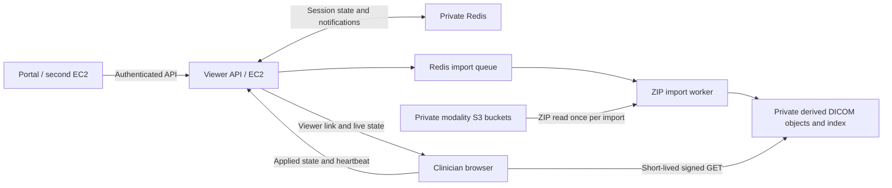

# EC2 viewer service

The second EC2 (your portal/backend) imports a ZIP, waits for indexing, creates a session, and gives the returned viewer URL to the clinician. It controls that session through an authenticated HTTP API. The browser receives updates over a streaming HTTP connection and sends its applied state back to the service.



## Storage layout

The example configuration maps your supplied bucket names as follows. Confirm their actual region is `ap-south-1` before deployment.

| API modality | Source bucket | Allowed key prefix |
| --- | --- | --- |
| `CT` | `decxpert-studies` | `CT/` |
| `MRI` | `decxpert-mri` | `MRI/` |
| `XRAY` | `decxpert-xray` | `Xray/` |
| `MAMMOGRAPHY` | `decxpert-mammography` | `Mammography/` |

For example, an input is `CT/study-123/archive.zip`, not an `s3://` URL. Prefixes and case must match your real keys. The worker reads the original archive without changing it and writes extracted DICOM objects plus `manifest.json` under `s3://decxpert-studies/viewer-derived/<import-id>/`. Change `S3_BUCKET` if derived objects should live in a separate bucket. Only the derived bucket requires browser CORS.

Each import has its own ID. Store that ID in your portal and reuse it when opening additional sessions. Importing the same ZIP again currently makes another copy; automatic source-version deduplication is not implemented. Do not overwrite a source ZIP while an import is retrying. Use immutable source keys or add object-version pinning before using mutable keys.

## EC2 deployment

1. Use an EC2 host with Docker Engine and the Compose plugin. Place the viewer, portal, Redis and S3 in the same AWS region where practical. The supplied Redis hostname contains `cac1`, which appears to indicate Canada Central; verify it in AWS. A Mumbai-to-Canada connection needs cross-region private routing and adds latency. Prefer a Redis endpoint in Mumbai for this deployment.
2. Attach an EC2 IAM instance role with the S3 policy in [viewer-iam-policy.json](../deploy/viewer-iam-policy.json). This uses the AWS SDK credential chain; no AWS access key belongs in the frontend or image. Container access to IMDSv2 may require an instance metadata hop limit of 2. If S3 uses SSE-KMS, grant the role the corresponding KMS decrypt/encrypt/data-key permissions through your key policy as well. [AWS EC2 IAM roles](https://docs.aws.amazon.com/AWSEC2/latest/UserGuide/iam-roles-for-amazon-ec2.html)
3. Copy `.env.example` to `.env`. Set `PUBLIC_URL` to the actual HTTPS viewer origin. Generate a new independent `SERVICE_API_KEY` with `openssl rand -hex 32`; store it on the viewer and portal servers only. Set the Redis URL, credentials if required, and `REDIS_CLUSTER_MODE=true` for ElastiCache Serverless. Do not reuse any credential pasted into chat.
4. Allow the viewer security group to reach Redis on TLS port 6379 and S3. ElastiCache Serverless requires TLS and cluster protocol; the implementation uses a cluster client and a BullMQ hash-tagged queue prefix. Keep Redis private. [AWS connection requirements](https://docs.aws.amazon.com/AmazonElastiCache/latest/dg/wwe-troubleshooting.html), [BullMQ cluster configuration](https://docs.bullmq.io/patterns/redis-cluster)
5. Put an HTTPS Application Load Balancer (or an HTTPS reverse proxy) in front of API port 3000. Restrict inbound 3000 to the ALB and any intentionally allowed private controller path. Set the health check to `/healthz`. Route `/api/*` and the frontend to the same service. Disable buffering for `/api/viewer/*/events`; the server emits a heartbeat every 10 seconds. With nginx, use `proxy_buffering off` and `proxy_read_timeout 60s` for this path. Use HTTPS for the controller API too.
6. Apply [s3-cors.json](../deploy/s3-cors.json) to the derived bucket after replacing the example viewer origin. Keep S3 Block Public Access enabled. Merge with any existing CORS rules instead of replacing other applications' rules.
7. Start both processes:

   ```bash
   docker compose up -d --build
   docker compose logs -f api worker
   curl http://127.0.0.1:3000/healthz
   ```

The API and worker use the same image but separate processes. There is no public Redis container in this Compose file. The API health endpoint checks its Redis connections; it does not prove S3 access or worker health. Validate a real import before directing clinicians to the service.

For local development, use a reachable development Redis, set `REDIS_CLUSTER_MODE=false` for standalone Redis, set `PUBLIC_URL=http://127.0.0.1:5173`, and run `npm run dev:api`, `npm run dev:worker`, and `npm run dev` in separate terminals. Match the Vite port if it chooses another one.

## API workflow from the portal EC2

All `/api/v1/*` endpoints require `Authorization: Bearer <SERVICE_API_KEY>`. The portal is responsible for checking its user's identity and study entitlement before creating a viewer link. The browser receives a separate expiring session token that cannot call controller endpoints.

### 1. Import a study

```http
POST /api/v1/studies
Authorization: Bearer <service-key>
Content-Type: application/json

{"modality":"CT","zipKey":"CT/study-123/archive.zip"}
```

Returns HTTP 202 with `{ "id": "<study-id>", "status": "queued", "statusUrl": "/api/v1/studies/<study-id>" }`. Poll `GET /api/v1/studies/<study-id>` until `status` is `completed`. The response includes the indexed manifest and `skippedFiles`. `failed` means the import exhausted its retries. Jobs retry three times; worker processes recover stalled jobs using BullMQ. Completed jobs are retained so import IDs remain usable. Plan Redis persistence/capacity and a coordinated retention policy for old job records and derived S3 objects; no automatic study deletion is configured.

The importer enforces compressed size, total expanded size, entry size and entry count limits. It handles nested folders, but does not recursively unpack nested ZIP files. Non-DICOM entries, unsupported codecs and multiframe instances are skipped and counted. An archive with no supported single-frame images fails. Duplicate SOP Instance UIDs fail to avoid ambiguous image selection. `skippedFiles > 0` requires inspection before assuming the complete study is available. Failed imports can leave partial derived objects in that import's prefix; remove them through your retention process after investigation.

### 2. Create a viewer session

```http
POST /api/v1/sessions
Authorization: Bearer <service-key>
Content-Type: application/json

{"studyId":"<completed-study-id>"}
```

The response includes `id`, `revision`, `state`, `expiresAt` and `viewerUrl`. Open `viewerUrl` in the clinician's browser. Its access token is in the URL fragment, then moved into per-tab session storage. The session defaults to one hour; configure `SESSION_TTL_SECONDS` for 60–86400 seconds. A viewer link is a bearer capability: anyone holding it can view that session until expiry/revocation. Portal identity checks must happen before sharing it; the service does not implement clinician login.

### 3. Read and control the browser

`GET /api/v1/sessions/<session-id>` returns desired `state`, `revision`, and `lastClientStatus`. Obtain a valid `seriesId` from the returned state or build it as `<StudyInstanceUID>:<SeriesInstanceUID>` using the manifest. Slice indexes follow the viewer's geometrically sorted series and are zero-based.

```http
PUT /api/v1/sessions/<session-id>/state
Authorization: Bearer <service-key>
Content-Type: application/json

{
  "expectedRevision": 0,
  "state": {
    "layout": "1x1",
    "viewports": [{
      "seriesId": "<StudyInstanceUID>:<SeriesInstanceUID>",
      "instanceIndex": 25,
      "windowWidth": 1500,
      "windowCenter": -600,
      "camera": {
        "zoom": 1.5, "pan": {"x": 0, "y": 0},
        "rotation": 0, "flipH": false, "flipV": false, "inverted": false
      }
    }],
    "activeTool": "windowLevel",
    "cinePlaying": false,
    "cineFps": 10,
    "mprOpen": false,
    "measurements": []
  }
}
```

This replaces desired state. Start from the latest state and edit the fields you need; omission resets schema-defaulted fields. Supply both window width and center together, or omit both to use image defaults. `expectedRevision` prevents controllers from overwriting each other. HTTP 409 means read the latest session, merge your change and retry. To switch studies, add a top-level `studyId` and supply valid state for that completed import.

| Control | State field |
| --- | --- |
| Layout | `layout`: `1x1`, `1x2`, `2x1`, `2x2`; supply exactly 1, 2, 2, or 4 viewports |
| Series and slice | Per-viewport `seriesId`, `instanceIndex` |
| Window / level | Per-viewport `windowWidth`, `windowCenter` |
| Zoom, pan, rotate, flip, invert | Per-viewport `camera` |
| Cine | `cinePlaying`, `cineFps` |
| Tools | `activeTool`: windowLevel, pan, zoom, length, angle, rectangleRoi, ellipseRoi, probe, annotation |
| Measurements / annotations | Replace `measurements`; remove an entry to undo/delete, or send `[]` to clear |
| MPR and volume | `mprOpen`, optional `mpr` settings below |
| Dialogs | Optional `dialogs`: `dicomTagsOpen`, `shortcutsOpen`, `exportOpen` |

Measurements use the existing viewer model; controller-supplied measurement values and labels are displayed as supplied, not recomputed by the API. Use browser-created measurements from reported state if you need the viewer's calculation. The server validates that their image/study references belong to the session.

Optional `mpr` settings expose the MPR slice planes and volume UI:

```json
{
  "indices": { "axial": 25, "coronal": 256, "sagittal": 256 },
  "windowWidth": 1500,
  "windowCenter": -600,
  "volumePreset": "lung",
  "renderMode": "mpr",
  "volumeWindowWidth": 1500,
  "volumeWindowCenter": -650,
  "volumeOpacity": 0.32,
  "slabThickness": 0.18,
  "volumeQuality": "hd",
  "fourDCine": false,
  "autoRotate": false,
  "camera": { "position": [2.5, 1.8, 2.5], "target": [0, 0, 0] }
}
```

Plane indexes are clamped to volume dimensions. Presets are `lung|soft|bone|mip`; rendering modes are `mpr|dvr|mip|minip|aip`; quality is `fast|hd|ultra`. Apply these with `mprOpen: true`. They take effect when the volume is loaded. The full schema is [src/types/remote.ts](../src/types/remote.ts).

An accepted PUT is not proof that pixels have rendered. `lastClientStatus.appliedRevision` confirms that the browser applied the viewing state; image downloads and MPR construction may still be running. Reported state/heartbeat is sent at most once per second when changing and every 10 seconds when idle. Check `seenAt` to detect stale browser status. With multiple browsers on one session, all receive controller updates; `lastClientStatus` is the most recently reporting browser, identified by `clientId`. Browser gestures are reported but are not automatically broadcast to other browsers. Native file pickers, browser download permissions and operating-system UI are outside this API.

Rapid updates can coalesce into the latest desired state. Reconnecting browsers receive a fresh snapshot, and a 10-second server refresh recovers notifications lost during a Redis subscriber disconnect. Pub/Sub itself is at-most-once, so the persistent session state is the source of truth. [Redis delivery semantics](https://redis.io/docs/latest/develop/pubsub/)

### 4. Revoke a session

`DELETE /api/v1/sessions/<session-id>` returns 204, ends streaming access and rejects further API requests with that viewer token. Previously issued S3 URLs can remain valid for up to five minutes, and already downloaded images cannot be recalled. S3 URL expiry is independent of session revocation. [AWS presigned URLs](https://docs.aws.amazon.com/AmazonS3/latest/userguide/using-presigned-url.html)

See [control-viewer.mjs](../examples/control-viewer.mjs) for an executable portal-side import/open/control example. Run it with the service URL and key in environment variables. It prints a viewer capability URL; keep its output private.

## Performance and current limits

- Import the archive as soon as it reaches S3, before the clinician opens it. Initial import must read, unzip, parse and write the archive; there is no claim of instantaneous first import.
- The indexed path downloads only requested images. Nearby signed URLs are batched, downloads are deduplicated and limited to six at a time, and each viewport prefetches up to eight neighbors in each direction.
- DICOM parsing uses a reusable browser worker. Decoded frames have a 512 MiB cache budget; current viewport frames and MPR volume memory are additional. Detailed DICOM tags are excluded from the startup manifest and arrive with an image.
- MPR requires the complete selected series. Its volume uses four bytes per voxel: 512×512×2000 alone is about 1.95 GiB, before textures/caches. Full-size MPR on large CT studies remains constrained by browser RAM/GPU capacity. 2D browsing does not require that allocation.
- Source ZIP upload, report generation, clinician authentication, radiologist scheduling, DICOMweb and durable annotation storage remain portal responsibilities. Measurement state lasts only for the session unless the portal saves it.
- No production latency numbers are available yet. Measure cold-import time, warm time-to-first-image, p95 slice-load time and control-to-browser-ack latency against representative CT and X-ray studies from the actual deployment region.
- Automated tests use synthetic DICOM ZIPs and an in-memory session adapter for HTTP tests. They do not establish production Redis Cluster, S3 CORS/IAM, browser GPU or Docker/EC2 correctness; validate those on the target infrastructure.
