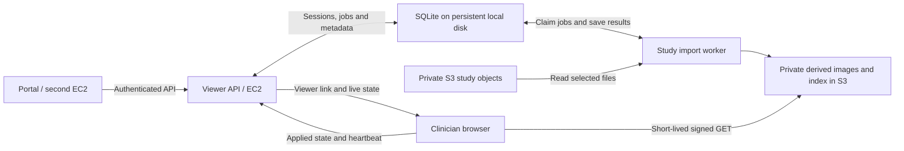

# EC2 viewer service

The portal/backend imports a study from S3, waits for indexing, creates a session, and gives the returned viewer URL to the clinician. Sources can be ZIP archives, individual DICOM/JPEG/PNG files, or a study folder containing a mixture. The API and viewer share `https://dicom.admindectrocel.online`. The browser receives updates over a streaming HTTP connection and sends its applied state back to the service.



## Storage layout

The supplied configuration uses bucket `animesh-arn` in `us-east-1`:

| Purpose | Bucket | Key prefix |
| --- | --- | --- |
| Main portal studies | `animesh-arn` | `test/hospitals/` |
| Additional studies | `animesh-arn` | `test/studies/` |
| Generated viewer data | `animesh-arn` | `test/viewer-derived/` |

Use complete object keys such as `test/hospitals/<hospital>/<study>/archive.zip`, not `s3://` URLs. The bracketed segments are examples; pass actual keys from your portal. Original objects are read without modification. Indexed images and `manifest.json` are written under `test/viewer-derived/<import-id>/`. The viewer does not read `test/reports/`, `test/downloads/`, or `test/temp/`. All modalities use the shared locations unless both bucket and prefix overrides are configured for that modality. `S3_ADDITIONAL_SOURCE_PREFIXES` is a comma-separated list of extra allowed prefixes, each ending in `/`; the portal's generic `S3_PREFIX=test` is not a substitute for these explicit viewer settings.

An import's ID is derived from the source bucket, sorted keys, object versions (ETag, VersionId and size), and derived-frame format version. Repeating the same selection reuses the existing import (`200`, `"reused": true`). A changed object or folder membership creates a new import; key order does not matter. The worker checks each GET response against the captured version and fails if an object changed after the request. Retry the API request to capture the new versions. Folder selection is a snapshot of its listing, not a live subscription.

## EC2 deployment

1. Use one EC2 host with Docker Engine and the Compose plugin, near the S3 bucket in `us-east-1` where practical. The API and worker share a persistent local disk volume; no Redis or external database service is required. For a native installation, use Node.js 24 or newer.
2. Attach an EC2 IAM instance role with the S3 policy in [viewer-iam-policy.json](../deploy/viewer-iam-policy.json). This uses the AWS SDK credential chain; no AWS access key belongs in the frontend or image. Container access to IMDSv2 may require an instance metadata hop limit of 2. If S3 uses SSE-KMS, grant the role the corresponding KMS decrypt/encrypt/data-key permissions through your key policy as well. [AWS EC2 IAM roles](https://docs.aws.amazon.com/AWSEC2/latest/UserGuide/iam-roles-for-amazon-ec2.html)
3. Copy `.env.example` to `.env` if absent. `PUBLIC_URL` is `https://dicom.admindectrocel.online`. Generate an independent `SERVICE_API_KEY` with `openssl rand -hex 32`; store it on the viewer and portal servers only. Use the EC2 role or rotated server-only AWS credentials; never reuse exposed credentials. The AWS SDK reads `AWS_ACCESS_KEY_ID`, `AWS_SECRET_ACCESS_KEY`, and optional `AWS_SESSION_TOKEN` from the server environment.
4. Allow outbound HTTPS access to S3. Set `VIEWER_DATA_DIR` to a writable persistent directory shared by API and worker. Compose supplies `/app/data` on its `viewer-data` named volume and runs both containers as the `node` user. Native processes must use the same absolute directory. Keep this SQLite directory on local/EBS storage on one host, not on NFS/EFS or independent container filesystems. It contains session and study metadata; retain it across deployments and restrict filesystem access.
5. Point the domain's DNS at the server/load balancer and provision TLS. [nginx.conf](../deploy/nginx.conf) is a template for a same-host nginx proxy; install it only after the referenced certificate exists, then validate with `nginx -t`. Compose binds port 3000 to loopback for that arrangement. For an ALB deployment, intentionally change the port binding and restrict port 3000 to the ALB security group. Route `/api/*` and the frontend to the same service; `/healthz` is the health check. Streaming endpoints require buffering disabled and a read timeout above the 10-second heartbeat.
6. Merge [s3-cors.json](../deploy/s3-cors.json), already set to the supplied domain, with the bucket's existing CORS rules. Keep S3 Block Public Access enabled. Browser reads use short-lived signed URLs; AWS credentials never go to the frontend. The supplied IAM policy includes prefix-restricted `s3:ListBucket` for study-folder selection. [AWS prefix restrictions](https://docs.aws.amazon.com/AmazonS3/latest/userguide/amazon-s3-policy-keys.html)
7. Start both processes:

   ```bash
   docker compose up -d --build
   docker compose logs -f api worker
   curl http://127.0.0.1:3000/healthz
   ```

The API and worker use the same image but separate processes. `/healthz` checks access to the local SQLite database; it does not prove S3 access or worker health. Validate a real import before directing clinicians to the service. SQLite uses WAL transactions for coordination between these processes, through [Node's built-in SQLite module](https://nodejs.org/download/release/latest-v24.x/docs/api/sqlite.html).

Before starting, run `node --env-file=.env examples/check-storage.mjs` on the configured server. It checks credentials and listing access to the two source prefixes without printing object names or reading image data. It does not test writes or CORS. The configuration files alone do not deploy DNS, TLS, IAM, CORS or the application.

For local development, set `PUBLIC_URL=http://127.0.0.1:5173` and run `npm run dev:api`, `npm run dev:worker`, and `npm run dev` from the repository root in separate terminals. Both server processes default to `data/viewer.sqlite`. Match the Vite port if it chooses another one. Browser frame caching remains enabled for responsive scrolling; server image files continue to live in S3.

Back up the persistent directory with both processes stopped, or use a SQLite-aware live backup. Preserve the database and its WAL files together; copying only a live `viewer.sqlite` file can omit transactions. Deleting the volume loses active sessions and queued jobs. Completed S3 imports can be rediscovered from their version-derived IDs. Previous Redis sessions/jobs are not automatically migrated: recreate viewer sessions and resubmit pending imports when upgrading an existing installation.

## API workflow from the portal EC2

For a simpler entry point, `POST /api/v1/viewer-links` accepts the same source selection as study import and returns either HTTP 202 with import status or HTTP 201 with a ready viewer URL. See the [portal integration guide](portal-integration.md), including a reusable backend client and a Docker smoke test. The explicit import/status/session APIs below remain supported.

All `/api/v1/*` endpoints require `Authorization: Bearer <SERVICE_API_KEY>`. The portal is responsible for checking its user's identity and study entitlement before creating a viewer link. The browser receives a separate expiring session token that cannot call controller endpoints.

### 1. Import a study

```http
POST /api/v1/studies
Authorization: Bearer <service-key>
Content-Type: application/json

{"zipKey":"test/hospitals/<hospital>/<study>/archive.zip"}
```

Returns HTTP 202 with `{ "id": "<study-id>", "status": "queued", "reused": false, "statusUrl": "/api/v1/studies/<study-id>" }` for a new import, or HTTP 200 with `"reused": true` and the current status when this selection was already imported or is importing. HTTP 404 means a source was not found or is inaccessible. Poll `GET /api/v1/studies/<study-id>` until `status` is `completed`; its response includes the manifest and `skippedFiles`. Imports have up to three attempts, with 5- and 10-second retry delays. A worker renews its 60-second lease every 20 seconds; a crashed worker's job can be reclaimed after expiry. Atomic claims and ownership checks prevent stale workers from completing reclaimed jobs. A failed job can be explicitly retried by submitting the selection again. Completed jobs/indexes persist on disk; plan retention for the local database and derived S3 objects. Expired sessions are automatically removed, but study data is not automatically deleted.

Alternatively send `{"objectKeys":["test/hospitals/<hospital>/<study>/scan.zip","test/hospitals/<hospital>/<study>/slice.dcm","test/hospitals/<hospital>/<study>/photo.jpg","test/studies/<study>/image.png"]}`. A single ordinary image uses a one-element `objectKeys` array. To index a study folder recursively, send `{"sourcePrefix":"test/hospitals/<hospital>/<study>/"}`. Supply exactly one of `zipKey`, `objectKeys`, or `sourcePrefix`. Folder selection must be below an allowed root and end in `/`; importing the entire `test/hospitals/` or `test/studies/` root is rejected. The portal must select files belonging to the authorized study; this API does not infer patient ownership from object paths.

The importer enforces per-ZIP compressed size, per-entry size, and cumulative expanded size/entry count limits across all selected files. It handles folders inside ZIPs but does not recursively unpack nested ZIP files. Unsupported files and multiframe DICOM instances are skipped and counted. An import with no supported images fails. Duplicate SOP Instance UIDs fail, including when the same slice appears both directly and inside a ZIP. `skippedFiles > 0` requires inspection before assuming the complete study is available. Failed imports can leave partial derived objects under their isolated import prefix; no failed manifest is published.

JPEG/PNG originals are preserved without recompression. Server indexing reads image dimensions and JPEG EXIF orientation using [image-size](https://github.com/image-size/image-size/blob/main/Readme.md); full image decoding happens in the browser, so corrupt pixel payloads can still fail when opened. Ordinary images appear as individual series, preserve color and PNG transparency over black, and use pixel measurements without patient calibration. Raster images are limited to 64 megapixels and do not form a 3D volume.

### 2. Create a viewer session

```http
POST /api/v1/sessions
Authorization: Bearer <service-key>
Content-Type: application/json

{"studyId":"<completed-study-id>"}
```

The response includes `id`, `revision`, `state`, `expiresAt` and `viewerUrl`. Open `viewerUrl` in the clinician's browser. Its access token is in the URL fragment, then moved into per-tab session storage. The session defaults to one hour; configure `SESSION_TTL_SECONDS` for 60–86400 seconds. A viewer link is a bearer capability: anyone holding it can view that session until expiry/revocation. Portal identity checks must happen before sharing it; the service does not implement clinician login.

### 3. Read and control the browser

`GET /api/v1/sessions/<session-id>` returns desired `state`, `revision`, and `lastClientStatus`. Obtain a valid `seriesId` from the returned state or build it as `<StudyInstanceUID>:<SeriesInstanceUID>` using the manifest. Slice indexes follow the viewer's geometrically sorted series and are zero-based.

```http
PUT /api/v1/sessions/<session-id>/state
Authorization: Bearer <service-key>
Content-Type: application/json

{
  "expectedRevision": 0,
  "state": {
    "layout": "1x1",
    "viewports": [{
      "seriesId": "<StudyInstanceUID>:<SeriesInstanceUID>",
      "instanceIndex": 25,
      "windowWidth": 1500,
      "windowCenter": -600,
      "camera": {
        "zoom": 1.5, "pan": {"x": 0, "y": 0},
        "rotation": 0, "flipH": false, "flipV": false, "inverted": false
      }
    }],
    "activeTool": "windowLevel",
    "cinePlaying": false,
    "cineFps": 10,
    "mprOpen": false,
    "measurements": []
  }
}
```

This replaces desired state. Start from the latest state and edit the fields you need; omission resets schema-defaulted fields. Supply both window width and center together, or omit both to use image defaults. `expectedRevision` prevents controllers from overwriting each other. HTTP 409 means read the latest session, merge your change and retry. To switch studies, add a top-level `studyId` and supply valid state for that completed import.

| Control | State field |
| --- | --- |
| Layout | `layout`: `1x1`, `1x2`, `2x1`, `2x2`; supply exactly 1, 2, 2, or 4 viewports |
| Series and slice | Per-viewport `seriesId`, `instanceIndex` |
| Window / level | Per-viewport `windowWidth`, `windowCenter` |
| Zoom, pan, rotate, flip, invert | Per-viewport `camera` |
| Cine | `cinePlaying`, `cineFps` |
| Tools | `activeTool`: windowLevel, pan, zoom, length, angle, rectangleRoi, ellipseRoi, probe, annotation |
| Measurements / annotations | Replace `measurements`; remove an entry to undo/delete, or send `[]` to clear |
| MPR and volume | `mprOpen`, optional `mpr` settings below |
| Dialogs | Optional `dialogs`: `dicomTagsOpen`, `shortcutsOpen`, `exportOpen` |

Measurements use the existing viewer model; controller-supplied measurement values and labels are displayed as supplied, not recomputed by the API. Use browser-created measurements from reported state if you need the viewer's calculation. The server validates that their image/study references belong to the session.

Optional `mpr` settings expose the MPR slice planes and volume UI:

```json
{
  "indices": { "axial": 25, "coronal": 256, "sagittal": 256 },
  "windowWidth": 1500,
  "windowCenter": -600,
  "volumePreset": "lung",
  "renderMode": "mpr",
  "volumeWindowWidth": 1500,
  "volumeWindowCenter": -650,
  "volumeOpacity": 0.32,
  "slabThickness": 0.18,
  "volumeQuality": "hd",
  "fourDCine": false,
  "autoRotate": false,
  "camera": { "position": [2.5, 1.8, 2.5], "target": [0, 0, 0] }
}
```

Plane indexes are clamped to volume dimensions. Presets are `lung|soft|bone|mip`; rendering modes are `mpr|dvr|mip|minip|aip`; quality is `fast|hd|ultra`. Apply these with `mprOpen: true`. They take effect when the volume is loaded. The full schema is [src/types/remote.ts](../src/types/remote.ts).

An accepted PUT is not proof that pixels have rendered. `lastClientStatus.appliedRevision` confirms that the browser applied the viewing state; image downloads and MPR construction may still be running. Reported state/heartbeat is sent at most once per second when changing and every 10 seconds when idle. Check `seenAt` to detect stale browser status. With multiple browsers on one session, all receive controller updates; `lastClientStatus` is the most recently reporting browser, identified by `clientId`. Browser gestures are reported but are not automatically broadcast to other browsers. Native file pickers, browser download permissions and operating-system UI are outside this API.

Rapid updates can coalesce into the latest desired state. The API notifies its connected browsers immediately after committing a change to SQLite. Reconnecting browsers receive a fresh snapshot, and a 10-second refresh recovers missed notifications from the persisted session state. Run one API instance for immediate notifications; additional API processes sharing the same local database observe each other's changes at the next refresh. This is a single-host deployment, not a distributed multi-host queue.

### 4. Revoke a session

`DELETE /api/v1/sessions/<session-id>` returns 204, ends streaming access and rejects further API requests with that viewer token. Previously issued S3 URLs can remain valid for up to five minutes, and already downloaded images cannot be recalled. S3 URL expiry is independent of session revocation. [AWS presigned URLs](https://docs.aws.amazon.com/AmazonS3/latest/userguide/using-presigned-url.html)

See [control-viewer.mjs](../examples/control-viewer.mjs) for an executable portal-side import/open/control example. Run it with the service URL and key in environment variables. It prints a viewer capability URL; keep its output private.

## Performance and current limits

- Import the archive as soon as it reaches S3, before the clinician opens it. Initial import must read, unzip, parse and write the archive; there is no claim of instantaneous first import.
- The indexed path downloads only requested images. Nearby signed URLs are batched, downloads are deduplicated and limited to six at a time, and each viewport prefetches up to eight neighbors in each direction.
- DICOM parsing uses a reusable browser worker. Decoded frames have a 512 MiB cache budget; current viewport frames and MPR volume memory are additional. Detailed DICOM tags are excluded from the startup manifest and arrive with an image.
- MPR requires the complete selected series. Its volume uses four bytes per voxel: 512×512×2000 alone is about 1.95 GiB, before textures/caches. Full-size MPR on large CT studies remains constrained by browser RAM/GPU capacity. 2D browsing does not require that allocation.
- Source ZIP upload, report generation, clinician authentication, radiologist scheduling, DICOMweb and durable annotation storage remain portal responsibilities. Measurement state lasts only for the session unless the portal saves it.
- No production latency numbers are available yet. Measure cold-import time, warm time-to-first-image, p95 slice-load time and control-to-browser-ack latency against representative CT and X-ray studies from the actual deployment region.
- Automated tests cover synthetic studies, HTTP authorization, and real SQLite persistence, revisions, leases and recovery. They do not establish production S3 CORS/IAM or Docker/EC2 correctness; validate those on the target infrastructure.
